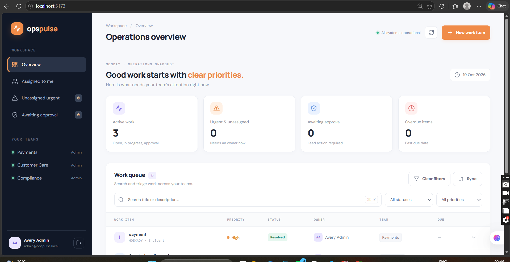
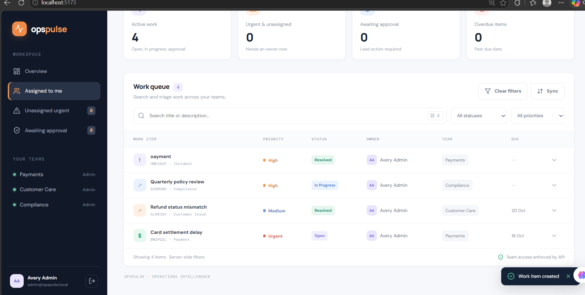
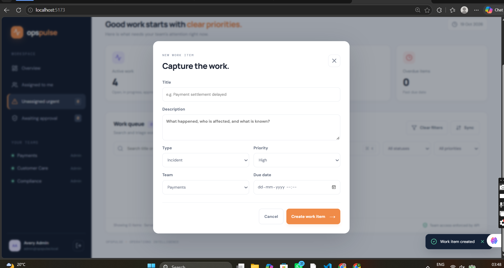
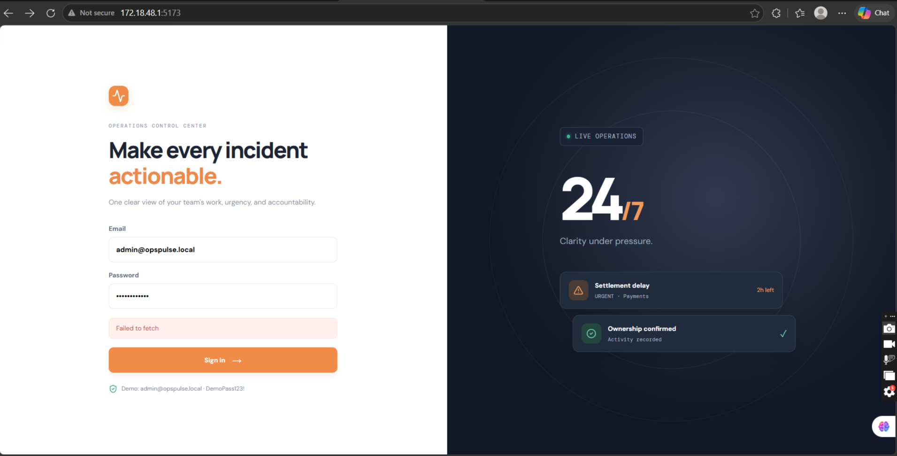

# OpsPulse — Operations Intelligence & Incident Control

OpsPulse is a full-stack operational work queue for teams handling incidents, payment issues, customer problems, compliance work, and tasks. It demonstrates team-scoped authorization, workflow validation, activity history, optimistic concurrency, idempotent creation, server-side filtering, and a PostgreSQL-backed outbox worker.

## Features

- JWT login with seeded demo users
- Team memberships with Viewer, Member, Lead, and Admin roles
- Create and view operational work items
- Server-side search, status/priority filters, team-scoped results, and cursor pagination
- Dashboard counters for active work, urgent unassigned work, approvals, and overdue items
- Atomic work-item claiming
- Version-checked edits that reject stale updates with `409 Conflict`
- Server-enforced workflow transitions and Lead/Admin approval checks
- Activity history and comments
- Idempotency keys for create requests
- Transactional outbox jobs with retries and a maximum-attempt limit
- React + TypeScript frontend and Express + TypeScript API

## Tech Stack

- **Frontend:** React, TypeScript, Vite, TanStack Query
- **API:** Node.js, Express, TypeScript, Zod
- **Database:** PostgreSQL, Prisma
- **Tests:** Vitest, Supertest
- **Local database:** Docker Compose

## Prerequisites

Install:

- Node.js 20 or newer
- npm
- Docker Desktop
- Git

Check your installations:

```bash
node --version
npm --version
docker --version
```

## Run Locally on Windows

Run commands from the project root (the folder containing this README and `docker-compose.yml`).

### 1. Start PostgreSQL

```powershell
docker compose up -d db
```

Wait until the database container is healthy.

### 2. Configure the server environment

Copy the example environment file:

```powershell
Copy-Item server/.env.example server/.env
```

The example file is intended for local development only. For a real deployment, use a strong, private `JWT_SECRET` and the database URL provided by your hosting service. Do not commit `.env` files or real secrets.

### 3. Install dependencies

```powershell
npm install
```

### 4. Generate Prisma Client, migrate, and seed

```powershell
npm run db:generate -w server
npm run db:migrate -w server
npm run db:seed -w server
```

If Prisma prompts for a new migration name on a fresh database, use `init`. If the database already has the project's migrations applied, do not create a duplicate migration; follow the prompt and current database state.

### 5. Start the application

The root command starts the API, frontend, and outbox worker together:

```powershell
npm run dev
```

Open:

- **Frontend:** http://localhost:5173
- **API health check:** http://localhost:4000/api/health

Stop the processes with `Ctrl+C`.

## Demo Accounts

All seeded demo users use the local development password `DemoPass123!`.

| Role | Email |
|---|---|
| Admin | `admin@opspulse.local` |
| Lead | `lead@opspulse.local` |
| Member | `member@opspulse.local` |
| Viewer | `viewer@opspulse.local` |
| Customer Care Lead | `carelead@opspulse.local` |

These credentials are for local assessment/demo use only. Never use them for a public production deployment.

## Run Tests and Build

Ensure PostgreSQL is running, the server environment is configured, and the Prisma client/migrations are ready.

Run the automated tests:

```powershell
npm test
```

Build the API and frontend:

```powershell
npm run build
```

The API tests are intended to cover critical behaviours including idempotent creation, concurrent claiming, stale-update rejection, role restrictions, cross-team access, and invalid workflow transitions. Report actual test/build results when submitting; do not claim they pass unless you have run them successfully.

## API Quick Reference

All endpoints except `/api/health` and `/api/auth/login` require an `Authorization: Bearer <token>` header.

| Method | Route | Purpose |
|---|---|---|
| `POST` | `/api/auth/login` | Log in |
| `GET` | `/api/auth/me` | Current user and memberships |
| `GET` | `/api/teams` | List the current user's teams |
| `GET` | `/api/dashboard/summary` | Dashboard counters |
| `GET` | `/api/items` | Filtered, paginated work-item list |
| `POST` | `/api/items` | Create an item; requires `Idempotency-Key` |
| `GET` | `/api/items/:id` | Item details, comments, and activity |
| `PATCH` | `/api/items/:id` | Version-checked edit |
| `POST` | `/api/items/:id/claim` | Claim an item atomically |
| `POST` | `/api/items/:id/transition` | Change workflow status |
| `POST` | `/api/items/:id/comments` | Add a comment |
| `GET` | `/api/items/:id/activity` | Read activity history |

## Screenshots and Demo

Add genuine screenshots from the running application if you want the repository page to show the UI. Recommended captures:

1. Dashboard with summary counters and work-item list
2. Work-item detail showing status, actions, comments, and activity history
3. A permission/workflow restriction or conflict message, if you can reproduce it safely


## Demo Video

[Watch the OpsPulse demo](https://drive.google.com/file/d/192w-R1VrMf8dRU_W7YCzoPGHXQsJdij4/view?usp=sharing)

Save the images under `docs/screenshots/`, then add them to this section using Markdown, for example:

```markdown








```

Do not use mockups as evidence of a working application. A 3–5 minute demo video is optional but recommended by the assessment. If you record one, add the shareable video URL here or include it in the submission form.

## Engineering Decisions

See [ENGINEERING_DECISIONS.md](./ENGINEERING_DECISIONS.md) for the reasoning and trade-offs behind the data model, authorization, concurrency, idempotency, transactional activity/outbox writes, and pagination.

## Known Limitations

- The outbox worker processes jobs and retries failures, but the demo handler logs the job rather than sending real notifications through an external provider.
- Authentication uses seeded accounts and JWTs; there is no sign-up flow, password reset, refresh-token rotation, or SSO.
- There is no production deployment pipeline, rate limiting, email delivery, attachment upload, or WebSocket push.
- Results are cursor-paginated by the API, but the UI currently displays the first 50 matching items; a load-more control would improve the experience.
- Idempotency records do not currently expire. A production implementation should define retention and request-fingerprint rules.
- The seed data is intentionally small; a scale test could seed thousands of items and compare query plans with `EXPLAIN ANALYZE`.
- Production deployment requires secure secrets, database configuration, and deployment-specific CORS settings.

